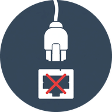

<div align="center">
  <a href="https://github.com/whitepaper2023/sfwall">
    
  </a>
  <h1>SfWall</h1>
  <strong>جدار حماية لأندرويد بدون VPN.</strong><br/>
  الخصوصية أولاً، محلي بالكامل، يعمل عبر Shizuku / خدمة ADB المحلية / الروت.
</div>

<p align="center">
  <a href="../README.md">English</a> ·
  <a href="README.tr.md">Türkçe</a> ·
  <a href="README.de.md">Deutsch</a> ·
  <a href="README.it.md">Italiano</a> ·
  <a href="README.pt.md">Português</a> ·
  <a href="README.cs.md">Čeština</a> ·
  <a href="README.ru.md">Русский</a> ·
  <b>العربية</b> ·
  <a href="README.hi.md">हिन्दी</a> ·
  <a href="README.zh.md">中文</a> ·
  <a href="README.ja.md">日本語</a>
</p>
<div style="height: 20px;">&nbsp;</div>
<p align="center">
  <a href="https://tooomm.github.io/github-release-stats/?username=whitepaper2023&repository=sfwall">
    
  </a>
  
  
</p>


<p align="center">
  <a href="https://www.buymeacoffee.com/ahmetcanarslan">
    
  </a>
</p>


## يعمل مع

أندرويد 11 أو أحدث وإحدى هذه الواجهات الخلفية:

- **Shizuku** (الإصدارات المشتقة مدعومة)
- **LibADB**: يقترن عبر التصحيح اللاسلكي، دون الحاجة إلى حاسوب
- **Root**

## لماذا SfWall

- **بدون VPN**: لا اعتراض للحزم ولا نفق دائم.
- **تحكّم لكل تطبيق**: يحظر الشبكة لكل تطبيق على حدة، بما في ذلك نسخ ملف العمل والنسخ المكرّرة.
- **خصوصية**: يعمل دون اتصال أولاً، بلا تحليلات وبلا قياس عن بُعد.
- **وصول سريع**: مربّع الإعدادات السريعة، أداة الشاشة والزر العائم.
- **الأتمتة**: يمكن التحكّم به عبر رسائل البث من adb و Tasker و MacroDroid وما شابه.

## لقطة الشاشة

<p align="center">
  
</p>

## كيف يعمل

يستخدم SfWall السلسلة **chain 3** في خدمة connectivity بأندرويد، وهي آلية في النظام تتحكّم في الوصول إلى الشبكة لكل حزمة:

```bash
cmd connectivity set-chain3-enabled true                                # تشغيل جدار الحماية
cmd connectivity set-package-networking-enabled false <package.name>   # حظر
cmd connectivity set-package-networking-enabled true <package.name>    # إلغاء الحظر
cmd connectivity set-chain3-enabled false                               # إيقاف جدار الحماية
```

يمسح أندرويد هذه القواعد عند إعادة التشغيل.

## الأتمتة

كل رسالة بث تحتاج إلى واجهة تحكّم نشطة. `apps` قائمة مفاتيح تطبيقات مفصولة بفواصل: اسم الحزمة المجرّد يستهدف المستخدم 0، والمفتاح ذو البادئة مثل `150:com.example.app` يستهدف النسخة الموجودة في ملف العمل أو مساحة النسخ تلك.

### جدار الحماية: `sfwall.CONTROL`

| المعامل | النوع | |
|---|---|---|
| `state` | boolean، مطلوب | `true` = حظر، `false` = إلغاء الحظر |
| `apps` | string، اختياري | التطبيقات المراد حظرها أو إلغاء حظرها. بدونه يبدّل البث حالة جدار الحماية كلّه. |

```bash
# تشغيل جدار الحماية (state false يوقفه)
adb shell am broadcast -a sfwall.CONTROL -n com.lu.sfwall/.receivers.FirewallControlReceiver --ez state true

# حظر تطبيق ونسخته في ملف العمل
adb shell am broadcast -a sfwall.CONTROL -n com.lu.sfwall/.receivers.FirewallControlReceiver --ez state true --es apps "com.example.app,150:com.example.app"
```

- مع `apps` يتبع التحديد داخل التطبيق: `state true` يحدّد التطبيقات ويشغّل جدار الحماية إن كان متوقفاً، و`state false` يلغي تحديدها ويُبقي جدار الحماية يعمل. في وضع القائمة البيضاء يشير `apps` إلى قائمة المسموح لها، فتنعكس الحالتان.
- عند إيقاف **إظهار التطبيقات في الملفات الشخصية الأخرى** يُطبَّق اسم الحزمة المجرّد على نسخه المكرّرة أيضاً. وعند تشغيله يُستهدف كل ملف شخصي عبر بادئته فقط.

### تطبيق جديد: `sfwall.APP_INSTALLED`

يُبلّغ عن تطبيق ثُبّت حديثاً، فتُطبَّق عليه سياسة التطبيقات الجديدة وإشعارها كما لو أن SfWall اكتشف التثبيت بنفسه. لا يرى SfWall إلا عمليات التثبيت في ملفه الشخصي، وهذه هي طريقة تغطية الملفات الأخرى.

```bash
adb shell am broadcast -a sfwall.APP_INSTALLED -n com.lu.sfwall/.receivers.AppInstalledReceiver --es apps "com.example.newapp"
```

لا يُطبَّق أي قاعدة أثناء إيقاف جدار الحماية. يتم تجاهل التطبيقات التي لا تملك إذن `INTERNET`.

### ملف التعريف: `sfwall.PROFILE`

يفعّل ملف تعريف محفوظاً: يكتب تحديد التطبيقات ووضع جدار الحماية وأوضاع التطبيقات المنفردة وإعداد *إظهار تطبيقات النظام*.

| المعامل | النوع | |
|---|---|---|
| `profile` | string | اسم ملف التعريف كما يظهر في قائمة ملفات التعريف. |
| `profile_id` | string | المعرّف الداخلي؛ يُفحص أولاً ولا يتأثر بإعادة التسمية. تعرض نافذة **أتمتة** الخاصة بملف التعريف الأمر جاهزاً. |
| `force_enable` | boolean، اختياري | تشغيل جدار الحماية بعد التبديل حتى لو كان متوقفاً. |

أحد `profile` أو `profile_id` مطلوب. إن لم يطابق أيٌّ منهما فلا يتغيّر شيء وتظهر رسالة قصيرة بذلك.

```bash
adb shell am broadcast -a sfwall.PROFILE -n com.lu.sfwall/.receivers.ProfileControlReceiver --es profile "Work"
```

## إخلاء المسؤولية

يُقدَّم SfWall **"كما هو"** دون أي ضمان. يعتمد على أذونات نظام متقدمة، والمطوّر غير مسؤول عن عدم استقرار النظام أو فقدان البيانات أو الآثار الجانبية لحظر الشبكة. تحقّق دائمًا من التطبيقات التي تحظرها.

أي ملفات APK من مكان آخر غير تابعة للمشروع وتُستخدم على مسؤوليتك. ليس لـ SfWall أي موقع ويب رسمي.

يُطلب إذن `INTERNET` فقط لاقتران التصحيح اللاسلكي (LibADB).

## الترخيص

[GPLv3](../LICENSE.md). بيانات تواقيع المتتبّعات المضمّنة مرخّصة بشكل منفصل وفق ODbL v1.0، انظر [TRACKER_DATA_LICENSE.md](../TRACKER_DATA_LICENSE.md).

## شكر وتقدير

- [Shizuku](https://github.com/RikkaApps/Shizuku): تنفيذ الأوامر ذات الصلاحيات.
- [LibADB](https://github.com/MuntashirAkon/libadb-android): تصحيح الأخطاء اللاسلكي والاتصال بالخدمة.
- [Exodus Privacy](https://exodus-privacy.eu.org/): قاعدة بيانات تواقيع المتتبّعات. يضمّ SfWall نسخة مختصرة منها ولا يتصل بواجهتهم البرمجية أبداً.
