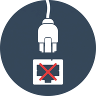

<div align="center">
  <a href="https://github.com/whitepaper2023/sfwall">
    
  </a>
  <h1>SfWall</h1>
  <strong>Firewall pro Android bez VPN.</strong><br/>
  Soukromí na prvním místě, pouze lokálně, poháněno Shizuku / lokálním ADB démonem / rootem.
</div>

<p align="center">
  <a href="../README.md">English</a> ·
  <a href="README.tr.md">Türkçe</a> ·
  <a href="README.de.md">Deutsch</a> ·
  <a href="README.it.md">Italiano</a> ·
  <a href="README.pt.md">Português</a> ·
  <b>Čeština</b> ·
  <a href="README.ru.md">Русский</a> ·
  <a href="README.ar.md">العربية</a> ·
  <a href="README.hi.md">हिन्दी</a> ·
  <a href="README.zh.md">中文</a> ·
  <a href="README.ja.md">日本語</a>
</p>
<div style="height: 20px;">&nbsp;</div>
<p align="center">
  <a href="https://tooomm.github.io/github-release-stats/?username=whitepaper2023&repository=sfwall">
    
  </a>
  
  
</p>


<p align="center">
  <a href="https://www.buymeacoffee.com/ahmetcanarslan">
    
  </a>
</p>


## Funguje s

Android 11+ a jeden z těchto backendů:

- **Shizuku** (forky jsou podporovány)
- **LibADB**: páruje se přes bezdrátové ladění, bez počítače
- **Root**

## Proč SfWall

- **Bez VPN**: žádné zachytávání paketů, žádný trvalý tunel.
- **Řízení po aplikacích**: blokuje síť jednotlivým aplikacím včetně kopií v pracovním profilu a klonů.
- **Soukromé**: offline-first, žádná analytika, žádná telemetrie.
- **Rychlý přístup**: dlaždice Rychlého nastavení, widget a plovoucí tlačítko.
- **Automatizace**: ovladatelné broadcasty z adb, Taskeru, MacroDroidu a podobných nástrojů.

## Snímek obrazovky

<p align="center">
  
</p>

## Jak to funguje

SfWall ovládá androidí connectivity **chain 3**, mechanismus platformy, který řídí přístup k síti po balíčcích:

```bash
cmd connectivity set-chain3-enabled true                                # firewall zapnut
cmd connectivity set-package-networking-enabled false <package.name>   # blokovat
cmd connectivity set-package-networking-enabled true <package.name>    # odblokovat
cmd connectivity set-chain3-enabled false                               # firewall vypnut
```

Android tato pravidla při restartu smaže.

## Automatizace

Každý broadcast vyžaduje aktivní backend. `apps` je seznam klíčů aplikací oddělených čárkou: samotný název balíčku míří na uživatele 0, klíč s prefixem jako `150:com.example.app` na kopii v daném pracovním profilu nebo klonovaném prostoru.

### Firewall: `sfwall.CONTROL`

| Extra | Typ | |
|---|---|---|
| `state` | boolean, povinné | `true` = blokovat, `false` = odblokovat |
| `apps` | string, volitelné | Aplikace k zablokování nebo odblokování. Bez něj broadcast přepíná celý firewall. |

```bash
# Zapnout firewall (state false ho vypne)
adb shell am broadcast -a sfwall.CONTROL -n com.lu.sfwall/.receivers.FirewallControlReceiver --ez state true

# Zablokovat aplikaci i její kopii v pracovním profilu
adb shell am broadcast -a sfwall.CONTROL -n com.lu.sfwall/.receivers.FirewallControlReceiver --ez state true --es apps "com.example.app,150:com.example.app"
```

- S `apps` se přizpůsobí i výběr v aplikaci: `state true` aplikace vybere a zapne firewall, pokud byl vypnutý; `state false` je z výběru odebere a firewall nechá zapnutý. V režimu whitelistu `apps` míří na seznam povolených, takže jsou oba stavy obrácené.
- Je-li **Zobrazit aplikace z jiných profilů** vypnuto, platí samotný název balíčku i pro jeho klony. Je-li zapnuto, každý profil se adresuje jen svým prefixem.

### Nová aplikace: `sfwall.APP_INSTALLED`

Oznámí nově nainstalovanou aplikaci, takže se na ni použijí pravidla i oznámení pro nové aplikace, jako by instalaci zaznamenal sám SfWall. SfWall vidí jen instalace ve vlastním profilu; takto lze pokrýt i ostatní.

```bash
adb shell am broadcast -a sfwall.APP_INSTALLED -n com.lu.sfwall/.receivers.AppInstalledReceiver --es apps "com.example.newapp"
```

Když je firewall vypnutý, nepoužije se žádné pravidlo. Aplikace bez oprávnění `INTERNET` se ignorují.

### Profil: `sfwall.PROFILE`

Aktivuje uložený profil: zapíše jeho výběr aplikací, režim firewallu, režimy jednotlivých aplikací a nastavení *Zobrazit systémové aplikace*.

| Extra | Typ | |
|---|---|---|
| `profile` | string | Název profilu, jak je uveden v seznamu profilů. |
| `profile_id` | string | Interní ID; kontroluje se jako první a přejmenování ho neovlivní. Dialog **Automatizace** u profilu ukazuje hotový příkaz. |
| `force_enable` | boolean, volitelné | Po přepnutí zapne firewall, i když byl vypnutý. |

Je vyžadováno `profile` nebo `profile_id`. Pokud žádné neodpovídá, nic se nezmění a oznámí to toast.

```bash
adb shell am broadcast -a sfwall.PROFILE -n com.lu.sfwall/.receivers.ProfileControlReceiver --es profile "Work"
```

## Prohlášení o odpovědnosti

SfWall je poskytován **„tak, jak je“**, bez záruky. Využívá pokročilá systémová oprávnění a vývojář neodpovídá za nestabilitu systému, ztrátu dat ani vedlejší účinky blokování sítě. Vždy si ověřte, které aplikace blokujete.

APK odjinud nejsou s projektem spojeny a používáte je na vlastní riziko. SfWall nemá žádné oficiální webové stránky.

Oprávnění `INTERNET` se vyžaduje jen pro párování bezdrátového ladění (LibADB).

## Licence

[GPLv3](../LICENSE.md). Přibalená data signatur trackerů jsou licencována samostatně pod ODbL v1.0, viz [TRACKER_DATA_LICENSE.md](../TRACKER_DATA_LICENSE.md).

## Poděkování

- [Shizuku](https://github.com/RikkaApps/Shizuku): spouštění privilegovaných příkazů.
- [LibADB](https://github.com/MuntashirAkon/libadb-android): bezdrátové ladění a připojení k démonu.
- [Exodus Privacy](https://exodus-privacy.eu.org/): databáze signatur trackerů. SfWall obsahuje její zkrácenou kopii a nikdy nekontaktuje jejich API.
